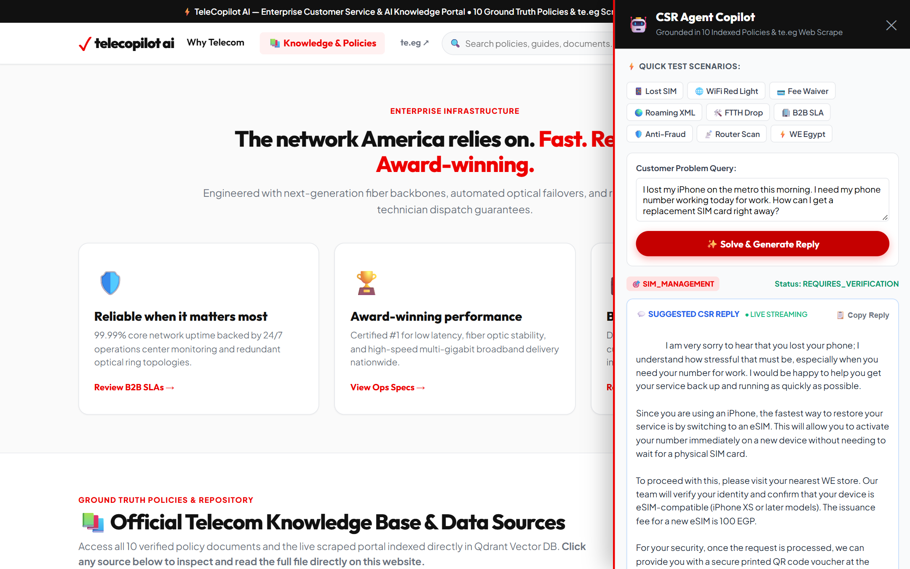
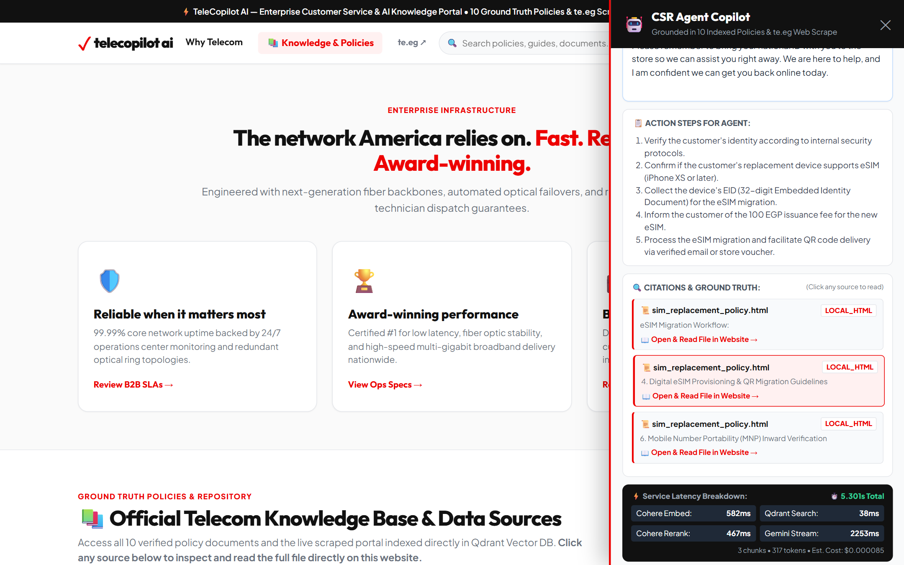
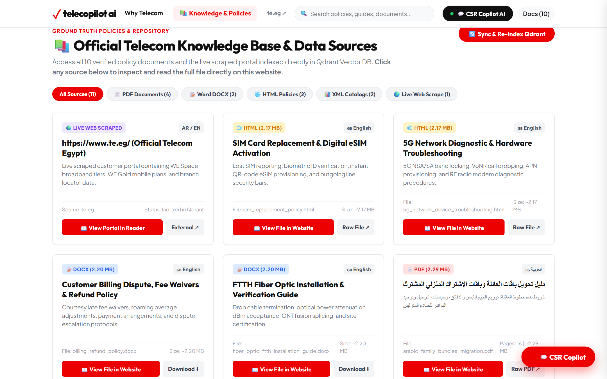
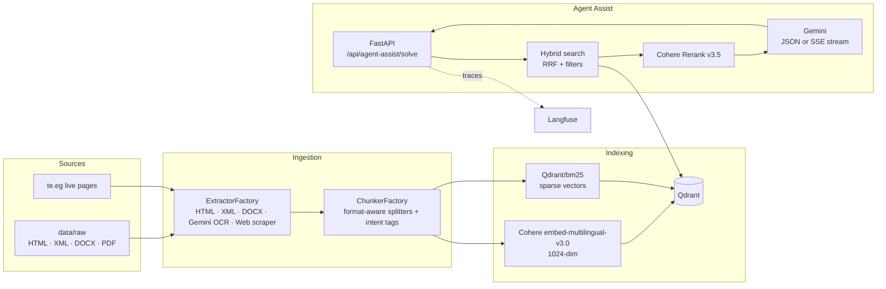
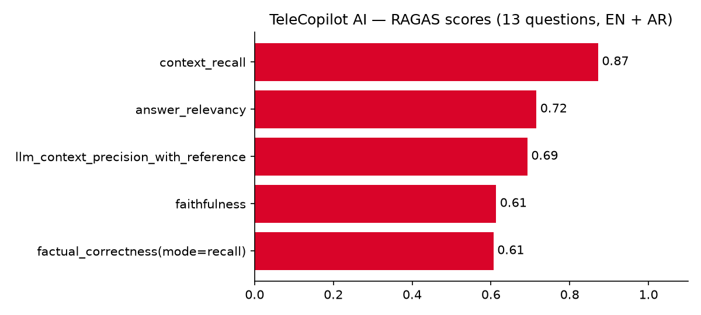

# TeleCopilot AI – Telecom Customer Service Agent Assist

TeleCopilot AI is a RAG copilot for telecom customer service representatives (CSRs). A CSR types the customer's
problem, and TeleCopilot searches the company's Arabic and English policy documents and live website pages, then
returns a ready-to-use resolution: the detected intent, the policy that applies, step-by-step actions, a suggested
reply to the customer, and citations to the exact sources. It also reports latency, tokens and cost for every request.

> The policy documents in `data/raw/` are sample telecom documents (Arabic and English) built for this project.
> Live pages are scraped from https://www.te.eg/.



---

## Demo

| CSR Copilot: action steps, citations and latency | Knowledge base: indexed sources (Arabic and English) |
|---|---|
|  |  |

---

## What it does

- **Multi-format ingestion.** Indexes 10 local policy documents (HTML, XML, DOCX, text PDFs and scanned PDFs) and
  4 live pages from te.eg into one Qdrant collection. Scanned and Arabic PDFs are read with **Gemini Vision OCR**.
- **Format-aware chunking.** Each format has its own LangChain splitter, so headers, steps and tables stay together.
  Every chunk is tagged with one of 12 intent categories (billing, SIM, roaming, fraud, broadband installation, and more).
- **Hybrid retrieval.** Cohere multilingual dense vectors + BM25 sparse vectors, fused in Qdrant with Reciprocal Rank
  Fusion (RRF), with optional filters on intent, source format and policy type.
- **Reranking.** Cohere Rerank v3.5 keeps the 3 most relevant chunks.
- **Grounded answers.** Gemini returns a structured JSON resolution, or streams the reply token by token over
  Server-Sent Events (SSE).
- **Observability.** Langfuse traces every stage (embedding, hybrid search, rerank, LLM) with latency, tokens and
  estimated cost.
- **Agent dashboard.** A web UI for CSRs, served by the same FastAPI app.

---

## Architecture



### Request flow

1. **Embed** the CSR query (dense + sparse).
2. **Hybrid search** in Qdrant: top 5 by RRF fusion, with optional intent / format / policy filters.
3. **Rerank** with Cohere Rerank v3.5 and keep the top 3.
4. **Generate** with Gemini, grounded in the reranked chunks.
5. **Return** the structured resolution (or stream it) with citations, latency breakdown, tokens and cost.

### Ingestion details

| Format | Extractor | Chunking strategy |
|---|---|---|
| HTML | `HTMLExtractor` | `HTMLHeaderTextSplitter` on h1–h3, then recursive split (500 / 80 overlap) |
| PDF (text or scanned, Arabic/English) | `GeminiOCRExtractor` | Gemini Vision → Markdown, `MarkdownHeaderTextSplitter`, then recursive split (600 / 100) |
| DOCX | `DocxExtractor` | Clause-aware recursive split (450 / 60) |
| XML | `XMLExtractor` | Recursive split (500 / 80) |
| Live web pages | `WebScraperExtractor` (httpx) | `HTMLHeaderTextSplitter`, then recursive split (650 / 120) |

**Intent categories:** `SIM_MANAGEMENT`, `NETWORK_TECHNICAL_SUPPORT`, `ROAMING_AND_INTERNATIONAL`,
`ENTERPRISE_B2B_SUPPORT`, `BILLING_AND_PAYMENTS`, `BROADBAND_INSTALLATION`, `FRAUD_AND_SECURITY`,
`ACCOUNT_MIGRATION_OFFERS`, `ROUTER_HARDWARE_SUPPORT`, `WIFI_TECHNICAL_SUPPORT`, `PLANS_AND_OFFERS`, `GENERAL_SUPPORT`.

### Response example (fields)

`POST /api/agent-assist/solve` returns:

| Field | Meaning |
|---|---|
| `customer_issue_summary` | One-line summary of the problem |
| `detected_intent` | One of the 12 intent categories |
| `policy_applied` / `primary_source_modality` | Which policy answered it, and from which format |
| `resolution_status` | Resolved, needs escalation, and so on |
| `actionable_agent_steps` | Step-by-step actions for the CSR |
| `suggested_customer_reply` | Ready-to-send reply |
| `policy_citations` | The top reranked sources |
| `sla_or_credit_details` | SLA or credit information when relevant |
| `latency_breakdown`, `total_tokens`, `estimated_cost_usd` | Per-request telemetry |

---

## Code structure

The app uses a layered **controller → service → repository** design, with **factories** for extractors and
chunkers, **singletons** for API clients and the database connection, and FastAPI dependency injection.

```
src/telecopilot/                 one installable package (pip install -e .)
├── api/                         main.py (FastAPI app), routers/, schemas.py, dependencies.py (DI wiring)
├── agent/assist_service.py      copilot orchestration: retrieve, then generate (batch JSON or SSE)
├── kb/
│   ├── extractors/              html, xml, docx, gemini_ocr, web_scraper
│   ├── chunkers/                format-aware policy chunkers
│   ├── factories.py             ExtractorFactory, ChunkerFactory
│   ├── repositories/            Qdrant repository (collection, upsert, hybrid search)
│   ├── sparse.py                BM25 sparse embeddings
│   ├── ingestion_service.py     extract → chunk → embed → upsert
│   └── models.py                document and chunk models
├── llm/                         Cohere (embed, rerank) and Gemini (generation) clients
├── core/                        logger (loguru), Langfuse observability, client singletons
└── config/settings.py           pydantic-settings configuration
static/                          CSR dashboard (HTML, CSS, JS)
tests/                           pytest suite, incl. v1 contract (golden files) and layer-import rules
```

---

## API

| Method | Endpoint | Purpose |
|---|---|---|
| POST | `/api/agent-assist/solve` | Structured JSON resolution |
| POST | `/api/agent-assist/solve/stream` | Token-by-token reply over SSE |
| POST | `/api/ingest/all` | Re-ingest all local documents and live pages |
| POST | `/api/ingest/scrape-url` | Scrape and index one URL |
| POST | `/api/scraper/run` | Run the scraper manually |
| GET | `/api/v1/policies` | List indexed policy documents |
| GET | `/api/v1/files/raw/{filename}` · `/api/v1/files/preview/{filename}` | Download or preview a source file |
| GET | `/api/health` | Health check |

---

## Tech stack

**Python** · **FastAPI** · **Qdrant** (hybrid dense + sparse, RRF) · **Cohere** (embed-multilingual-v3.0, rerank-v3.5) ·
**Gemini** (generation + Vision OCR) · **LangChain** text splitters · **Langfuse** · **loguru** · **Pydantic** ·
**Docker / Docker Compose** · **Pytest** · **GitHub Actions**

---

## Run it

### 1. Configure

Create a `.env` file:

```env
COHERE_API_KEY=your_cohere_key
GEMINI_API_KEY=your_gemini_key
LANGFUSE_PUBLIC_KEY=your_langfuse_public_key
LANGFUSE_SECRET_KEY=your_langfuse_secret_key
# optional
QDRANT_HOST=localhost
QDRANT_PORT=6333
```

### 2. Start with Docker Compose

```bash
docker compose up --build
```

This starts Qdrant (v1.13.0), Postgres 16, Redis 7 and the app (services in `deploy/compose/`). On first start, the
app ingests all local documents and live pages into Qdrant, then serves the dashboard at http://localhost:8000.
API keys are read from `.env` at runtime and never copied into the image. If another project already uses a port,
move ours, e.g. `QDRANT_HOST_PORT=6343 docker compose up` (also `APP_HOST_PORT`, `POSTGRES_HOST_PORT`, `REDIS_HOST_PORT`).

### 3. Or run locally

```bash
pip install -e ".[dev]"
uvicorn telecopilot.api.main:app --host 0.0.0.0 --port 8000 --reload
```

### 4. Tests

```bash
pytest -v
```

GitHub Actions runs the test suite and builds the Docker image on every push and pull request.

---

## Evaluation (RAGAS)

`evals/notebooks/03_rag_evaluation_ragas.ipynb` runs the production pipeline on 13 CSR questions (10 English, 3 Arabic)
across 8 intents. Every reference answer is taken from the human-verified ground truth in `data/ground_truth/`.
The notebook uses an embedded Qdrant instance, so the real hybrid RRF search is evaluated.

| Metric | Score |
|---|---|
| Source hit rate @3 (correct document in the reranked top 3) | **1.00** |
| Intent accuracy | **1.00** |
| Context recall | **0.87** |
| Answer relevancy | 0.72 |
| Context precision | 0.69 |
| Faithfulness | 0.61 |
| Factual correctness (recall) | 0.61 |
| Median end-to-end latency | 3.9 s |



**What the results show**

- **Retrieval is strong.** The right policy document reached the top 3 for every question, in English and Arabic.
- **Answers are the weak point.** The suggested reply mixes customer-friendly wording and generic agent steps that are
  not in the retrieved policy, which lowers faithfulness; some answers also leave out details (for example, not all
  approval tiers). Faithfulness is lower for Arabic questions (0.43 vs 0.65).
- **One retrieval miss:** for the bank-OTP-after-SIM-swap question, the chunk with the 24-hour OTP quarantine rule
  (SEC-88) was not in the top 3, so the answer gave generic troubleshooting.

Judge: `gemini-3.1-flash-lite-preview` (the same model as the app, so scores may be slightly generous), with Cohere
`embed-multilingual-v3.0` embeddings. Per-question scores are in `evals/reports/generation/v1/ragas_results.csv`.

---

## Roadmap

**v2 is planned** (agent desktop in Arabic + English, knowledge-base and data pipelines, five open-source models
chosen on Egyptian dialect evals, channels, agent with tools and memory, speech, measured local baseline).
See [docs/PLAN.md](docs/PLAN.md), [docs/SPRINTS.md](docs/SPRINTS.md) and [docs/design/](docs/design/).
The items below are the v1 follow-ups, folded into the v2 milestones.


- **Improve answer faithfulness:** a stricter grounding prompt (state only facts from the context, include every
  fee and threshold found), and a stronger judge model.
- **Improve retrieval for long scanned PDFs:** chunk by policy rule instead of by page, and test rerank top 5.
- **Extraction quality evaluation (in progress):** human-verified ground truth for all 10 documents, scored with
  word-level F1, ROUGE-L, entity and number retention, section order (Kendall's tau) and a Gemini LLM-as-a-judge,
  with Arabic normalization.
