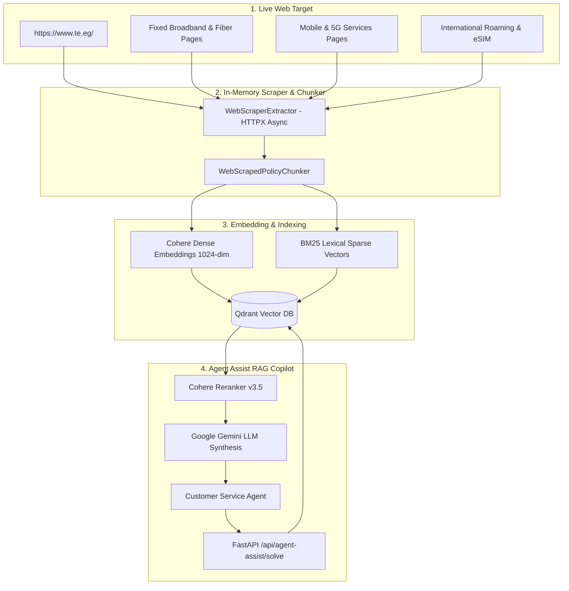

# ⚡ Telecom Customer Service Agent Assist - Pure Live Web Ingestion System

An enterprise-grade, containerized AI **Customer Service Copilot** operating **100% in-memory with zero local data files required**. All data is scraped live directly from online websites (e.g. [**https://www.te.eg/**](https://www.te.eg/)), parsed, and indexed directly into **Qdrant Vector DB** with Dense (Cohere) + Sparse (BM25) hybrid vectors.

---

## 🌐 Zero-Local-Disk Architecture



---

## 🚀 Key Highlights

1. **Zero Local Data Folder**:
   - No local HTML, PDF, or DOCX files needed on disk.
   - Live HTTP requests scrape the target website directly into RAM.
2. **Dual-Vector Hybrid Search**:
   - **Dense Vectors**: Semantic understanding with Cohere `embed-english-v3.0`.
   - **Sparse Vectors**: Exact keyword matching with BM25 term frequency hashing.
   - **Qdrant Collection**: Unified collection storing dense + sparse vectors with intent tags (`PLANS_AND_OFFERS`, `SIM_MANAGEMENT`, `WIFI_TECHNICAL_SUPPORT`, `BILLING_AND_PAYMENTS`).
3. **Observability & Design Patterns**:
   - **Langfuse** telemetry tracing latency, tokens, and retrieval accuracy.
   - **Singleton Pattern** (clients & DB connection).
   - **Factory Pattern** (extractors and chunkers).
   - **Controller-Service-Repository Pattern** (layered architecture).

---

## 🏃 Running the Application

### 1. Install Dependencies
```bash
pip install -r requirements.txt
```

### 2. Configure Environment
Set your API keys in `.env`:
```env
COHERE_API_KEY=your_cohere_key
GEMINI_API_KEY=your_gemini_key
LANGFUSE_PUBLIC_KEY=your_langfuse_public_key
LANGFUSE_SECRET_KEY=your_langfuse_secret_key
```

### 3. Run FastAPI Application
```bash
uvicorn api.main:app --host 0.0.0.0 --port 8000 --reload
# or with Docker
docker-compose up --build
```

On startup, the server automatically fetches and indexes [https://www.te.eg/](https://www.te.eg/) in-memory and opens the interactive dashboard at `http://localhost:8000`.
