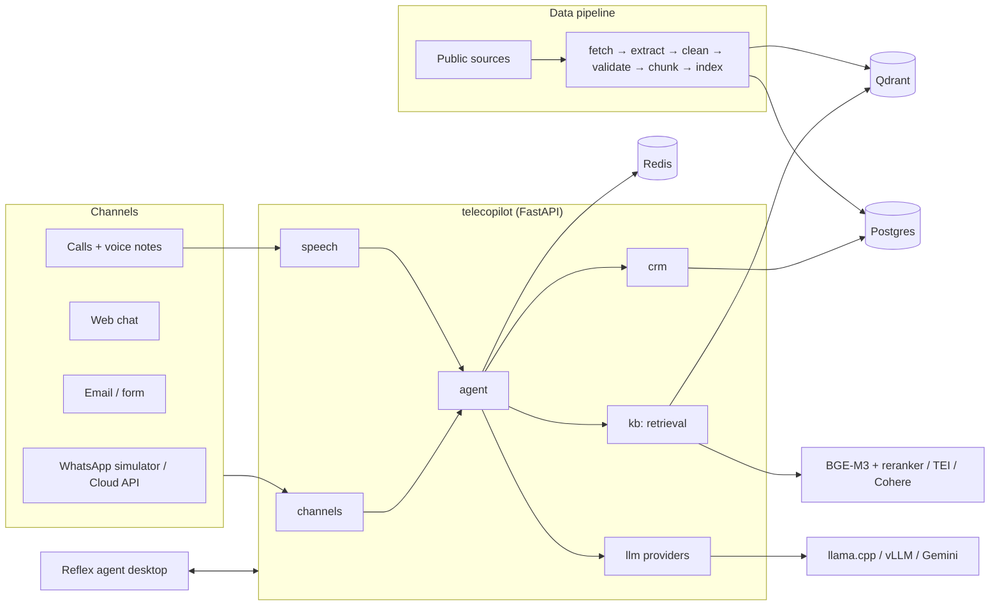

# Architecture Decisions — explained

An **ADR (Architecture Decision Record)** is a short note that records one important technical decision:
the **context** (the problem), the **options** we considered, the **decision**, **why**, and the **consequences**
(what we gain, what it costs). ADRs let anyone, including future you, understand *why* the system looks the way it
does, and change a decision deliberately instead of by accident. Each decision below is ADR-n in
[../SPRINTS.md](../SPRINTS.md). To change one, edit it here with a date and the reason.

## The big picture

Layers only call **downwards**: `api` → `agent` / `crm` / `kb` / `channels` → `llm` / repositories → databases.
Lower layers never import upper ones. That keeps parts testable and replaceable.

---

## ADR-1 — One installable package (`src/telecopilot/`)
- **Context:** today the code is under `src/` with `sys.path` tricks so imports like `from config.settings` work.
  That breaks easily (tests, Docker, notebooks) and names like `core` or `config` can clash with other libraries.
- **Options:** (a) keep as is · (b) several separate packages (a "monorepo" with many `pyproject` files) ·
  (c) **one package `telecopilot` with sub-packages**.
- **Decision:** (c). `pip install -e .`, then `from telecopilot.kb import ...` works everywhere.
- **Why:** standard Python layout, clear namespaces, simple for one developer. (b) is overkill for a solo project.
- **Consequence:** a one-time import rewrite in S01. The Reflex UI lives separately in `apps/web/` because Reflex
  has its own project structure.

## ADR-2 — Providers behind interfaces (Strategy pattern)
- **Context:** we want to swap Gemini ↔ llama.cpp ↔ vLLM, and Cohere ↔ local BGE-M3 ↔ TEI, to compare them
  and to learn deployment, without rewriting the app each time.
- **Pattern:** **Strategy**. The app depends on an interface (e.g. `LLMProvider.generate_json()`); the concrete
  class is picked from config (`LLM_PROVIDER=llamacpp`). The existing **Factory** pattern builds the right one.
- **Why:** comparisons are fair (same code, only the provider changes); tests use fake providers; fallbacks are
  explicit config, not hidden `try/except`.
- **Consequence:** small extra abstraction. llama.cpp and vLLM share one class because both speak the
  OpenAI-compatible HTTP API.

## ADR-3 — Local models
- **Context:** the laptop has a 4 GB GPU and limited internet.
- **Decision:** Qwen2.5-3B-Instruct (4-bit GGUF) on **llama.cpp** on the GPU; **BGE-M3** embeddings and
  **bge-reranker-v2-m3** on the CPU; **faster-whisper small** for speech.
- **Why:** llama.cpp runs quantised models in very little memory and works on Windows; vLLM needs a big GPU and
  Linux, so it waits for the cloud stage. Qwen is strong in Arabic for its size. BGE-M3 is multilingual and strong
  in Arabic. Keeping embeddings on the CPU leaves the GPU for the LLM.
- **Consequence:** a small model means lower answer quality than Gemini. That gap is exactly what Stage A measures.

## ADR-4 — Sparse retrieval stays BM25 (for now)
- **Context:** hybrid search = dense vectors (meaning) + sparse vectors (exact words such as plan names, codes,
  prices). Today sparse = BM25 in Qdrant.
- **Options:** BM25 · BGE-M3's own sparse output.
- **Decision:** keep BM25 until the M3 experiment shows BGE-M3 sparse is clearly better **and** can be served
  (TEI may not return BGE-M3 sparse vectors).
- **Why:** BM25 works, it is cheap, and it is already tested. Don't change two things at once.

## ADR-5 — Postgres + Redis (+ Qdrant)
- **Postgres** stores structured, relational data that must not be lost: customers, bills, tickets, conversations,
  KB source registry, audit log. **SQLAlchemy 2** maps tables to Python classes; **Alembic** versions the schema
  (migrations) so every change is repeatable. **Repository pattern** (already used for Qdrant) keeps SQL out of the
  services.
- **Redis** stores fast, short-lived data: the live session state of a conversation, pub/sub to push new messages to
  the UI, and background job queues.
- **Qdrant** stays for vectors (KB chunks, later memory).
- **Why not only one database?** Each does one job well. Postgres + pgvector could replace Qdrant later, but Qdrant's
  hybrid search is already built and evaluated.

## ADR-6 — Single company
- One telecom contact centre. No tenant isolation, billing or onboarding. That keeps the learning focus on the AI
  and data parts.

## ADR-7 — Reflex for the UI
- **Context:** we need a real agent desktop (inbox, 3-pane workspace, live updates, Arabic RTL).
- **Options:** React + Vite (most flexible, needs JavaScript skills) · HTMX (simple, limited for live dashboards) ·
  Streamlit/Gradio (demos, not real apps) · **Reflex** (Python, compiles to a React front end).
- **Decision:** Reflex, styled with Ziad's design/colour guide.
- **Why:** the whole project stays in Python. It is a real web app (routing, state, websockets), not a demo tool.
- **Consequence:** less flexible than hand-written React for very custom components. If a screen needs it, Reflex
  can wrap a React component.

## ADR-8 — LangGraph agent + typed tools + MCP
- **Context:** the copilot must read context, call tools (customer data, outages, tickets), then draft a grounded reply.
- **Options:** plain Python loop · LangChain agents · **LangGraph** · other frameworks.
- **Decision:** LangGraph: the agent is an explicit **state machine** (nodes = steps, edges = transitions).
- **Why:** each step is visible, testable and traceable; human approval steps fit naturally; streaming is built in.
  Tools are plain typed Python functions first; in M8 they are also exposed as **MCP** servers so any MCP-capable
  agent can use them.

## ADR-9 — Locust for load testing
- **Why:** written in Python, simulates realistic user behaviour (a CSR opening a ticket, the copilot answering),
  produces p50/p95 latency and error rates. Capacity = the most concurrent CSRs while p95 < 4 s and errors < 1%.

## ADR-10 — Data before models
- **Context:** retrieval and answer quality are limited by the data: bad extraction, missing prices, duplicates or
  stale pages produce wrong answers whatever the model.
- **Decision:** build and measure the KB pipeline (M2) before choosing models (M3).
- **Pipeline pattern:** a chain of small stages with **data contracts** between them:
  fetch → extract → clean / normalise → validate → chunk → enrich → index. Each stage writes its output and a
  quality record, so a run can be inspected, re-run and compared.
- **Consequence:** model work starts later, on solid, measured data.

## Patterns already in the code (kept)
| Pattern | Where | Why |
|---|---|---|
| Layered (controller → service → repository) | api / services / repositories | Separation of HTTP, logic and storage |
| Factory | extractor and chunker factories | Pick the right class per file format |
| Singleton | API/database clients | One shared client per process |
| Dependency injection | FastAPI `Depends` | Swap real clients for fakes in tests |
| Repository | Qdrant repository | Storage details hidden behind an interface |
